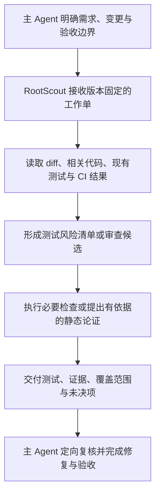

# RootScout 承接测试分析与代码审查：能力判断及最小改造方案

评估日期：2026-11-01。本文是方案，不是已经实现的新能力。

**判断：当前可以辅助单文件算法程序的测试探针设计、失败诊断和缺陷候选审查；尚不能完整承接真实仓库的测试分析与 PR 审查。现有外包实验也没有证明更好、更省、更快，已完成的小样本试验反而显示端到端耗时和已确认 Token 增加。**

可行的产品方向是：让 RootScout 承接范围明确的测试和变更审查工作，交付可复核的测试、证据及未决项，减少主 Agent 的重复探索。需求解释、任务边界、最终验收仍由主 Agent 负责。

## 1. 判断依据

### 当前生产能力

本次核对的 `root_scout.py` SHA-256 为 `bdc54e3b00bfca5abd21e2218b8ea113fb02faf5288113e5c7256d7971865e39`，与 README 记载的回退版本相同。代码入口要求 `statement`、`source`、`language`，语言仅接受 C++17、C++20、Python 3。

- 已有：候选保存与修订、有界探索、可信 expected 来源、Docker 执行、派生源码实验、调用账本、预算、快照及重放。
- 工具只有 `read_source`、`run_original`、`run_variant`；读取和编辑针对一份源码，执行器将其写成 `main.py` 或 `main.cpp`。
- 尚无仓库文件检索、base/head 版本、diff 与调用方关联、项目测试框架执行、CI 测试报告导入、覆盖率解释等正式接口。
- `v2_result()` 输出的每条 finding 均标为 `verification=unverified`；定位和因果解释仍是模型主张。
- 轻量结果仅含 findings；自动化接入必须额外检查 CaseState 与 CLI 状态，空数组不能代表完成检查且无问题。

代码依据：[请求校验](F:/AI-Tools/root-scout/root_scout.py:261)、[工具协议](F:/AI-Tools/root-scout/root_scout.py:90)、[执行器](F:/AI-Tools/root-scout/root_scout.py:1340)、[结果导出](F:/AI-Tools/root-scout/root_scout.py:4196)。

本次运行 `python -m unittest test_root_scout test_evaluation`，164 项检查全部通过。这支持控制器在这些测试覆盖范围内符合预期，不构成模型质量或外包收益证明。

### 已有外包实验直接说明了什么

| 实验 | 主 Agent 自行处理 A | 接入 RootScout B | 可得出的结论 |
|---|---:|---:|---|
| 六个合成开发任务，各重复两次：最终成功 | 12/12 | 12/12 | 未观察到最终成功率增加，存在天花板效应 |
| 同一开发实验：平均耗时 | 61.00 秒 | 134.82 秒 | B 约为 A 的 2.21 倍 |
| 同一开发实验：已确认总 Token | 943,952 | 1,310,603 | 已确认量增加 38.84%；B 另有两次用量未知 |
| 四个真实竞赛错误现场，各重复两次：最终成功 | 8/8 | 8/8 | 未观察到最终成功率增加 |
| 同一故障实验：平均耗时 | 79.56 秒 | 151.67 秒 | B 约为 A 的 1.91 倍 |
| 同一故障实验：总 Token | 669,588 | 1,293,894 | 增加 93.24%，两组用量完整 |

来源：[开发任务结果](F:/AI-Tools/root-scout/validation/development-outsourcing-v1/live-v1/report.md)、[故障诊断结果](F:/AI-Tools/root-scout/validation/failure-outsourcing-v1/live-v1/report.md)。

两轮使用冻结的 native/delta 实验快照，核心文件哈希为 `cf7807ea579dbd66f5b1b77a1582863bc06a7d7895dfc73e003d467d7f9450f2`，不能冒充当前 bdc54e3b 生产源码的同条件成绩。它们是单文件任务，不是仓库级测试分析或 PR 审查基准；诊断机制、采用情况和重复劳动还待语义复盘。没有可靠计费单价，Token 增幅不能直接称为费用增幅。

已有故障实验已经采用“修复前委托、明确故障、交接已做检查、共享截止时间”。因此这些做法属于已有接入基础，不能再次作为尚未验证的新降本机制。

当前生产版本另有一次 [40 份回归](F:/AI-Tools/root-scout/validation/bdc54e3b-full40-v1/report.md)：37 份完整可比样本总 Token 仅下降 2.92%，错误程序平均增加 1.40%；7/40 为 CLI 技术未完成，其中三份触发累计 SSE 16 MiB 限制。错误程序 16/20 出现功能候选只是警报覆盖，不是根因召回率。输出 Token 中约 97.09% 为服务端报告的 reasoning，压缩输入不必然解决主要推理开销。

## 2. 哪些任务适合承接

| 任务 | 当前适用程度 | 改造后的交付 |
|---|---|---|
| 算法程序边界输入、反例方向 | 可辅助；缺少可信预期时只能观察 | 输入、依据、原版观察、有限范围结论 |
| 已知失败的原因分析 | 可辅助；现有试验未显示总体效率收益 | 最小复现、失败机制、证据、未决问题 |
| 真实仓库“该跑哪些测试、还缺哪些测试” | 接口与上下文不足 | 需求到变更到测试的关联、优先级、遗漏及必要补测 |
| PR 引入的跨文件功能回归 | 缺少 base/head 与调用链 | 受影响路径、原有/新增问题区分、可复核的 finding |
| 通用安全、架构、性能审查 | 没有足够能力与评测证据 | 后续按专门契约和工具扩展，不纳入首版承诺 |

首版建议面向 Python 仓库，优先消费现有测试和 CI 产物；其他语言通过项目测试配置逐步接入。算法诊断入口继续承担适合它的单文件问题。

## 3. 目标工作流

同一任务的文件快照、检索、测试输出在测试分析与审查之间复用。主 Agent 可直接定位到原始证据并复跑关键检查，减少重新阅读全部代码和再次完整诊断的需要；关键结论的复核仍计入总成本。

### 测试分析入口 `test_analysis`

输入包含需求依据、变更快照、现有测试、失败日志及可用覆盖率。输出回答：

1. 哪些需求和调用路径受影响，依据是什么？
2. 哪些现有测试应执行，哪些已经执行且结果可复用？
3. 缺少哪些有实际风险的测试，断言的预期从哪里来？
4. 必要补测产生了什么可复现观察，还剩哪些覆盖缺口？

测试建议必须指出风险和需求依据。新测试先进入隔离副本；模型写出的断言不自动成为可信规则。优先导入项目已有 JUnit/XML、JSON 和覆盖率产物，执行时使用项目已配置的测试环境。

### 变更审查入口 `review_diff`

围绕变更检查被调用方、调用方、数据格式、异常路径、状态及资源生命周期。按需扩大读取范围，并披露无法确认的依赖；仅搜索直接调用方不能代表影响范围完整。

每条 finding 提供：版本与位置、触发条件、违反的需求或不变量、相关调用路径、影响、证据和未决点。区分新引入缺陷、已有缺陷和无法归因的问题。代码风格等确定性检查交给项目已有工具。

有复现条件时提供可执行检查；难以复现的问题可保留完整的静态推导和准确引用，不因暂时没有测试而删除候选，也不自动升为已确认缺陷。

## 4. 最小工程改造

### A. 增加仓库工作单与独立状态 schema

必要字段：`task_kind`、需求及来源、仓库快照清单、base/head 或两份快照、审查范围、已有证据、允许执行的检查 ID、环境标识和任务预算。Git 仓库固定实际 commit；没有 Git 元数据时接收两份显式快照并保存文件哈希。

PR 变更根据约定使用 merge base 到 head 的差异；部署回归等场景可指定两个实际版本直接比较。测试对照的 before 版本必须写清，不能默认所有任务都使用相同的比较语义。Git 官方对这两种差异有明确区分：[git diff 文档](https://git-scm.com/docs/git-diff)。

单文件 CaseState 的验证器不能直接证明多文件状态有效；仓库状态需要自己的文件、版本、证据和执行对应关系验证。

### B. 增加少量仓库工具

| 工具 | 最小职责 |
|---|---|
| `read_file` / `search` | 在固定快照内读取行范围、检索定义、调用方和测试，保留文件哈希与行号 |
| `run_check` | 根据调用方配置的检查 ID 和受约束的测试选择器执行，返回退出状态及原始产物 |
| `run_variant` 的仓库版本 | 在隔离副本应用有界补丁或新增测试，并对指定检查复验 |

检查 ID 映射为受信配置中的 argv、目录和环境，模型不提供任意 shell。读取和补丁路径校验实际解析后的仓库边界，处理符号链接/目录联接；执行环境不带凭据。项目依赖在可复现环境中准备，环境准备时间纳入报告。

执行结果分别记录断言失败、收集/导入失败、环境失败、超时、中断、无测试等状态。例如 pytest 对这些情况使用不同退出码，不能统一解释为业务缺陷：[pytest 退出码](https://docs.pytest.org/en/stable/reference/exit-codes.html)。

### C. 把执行事实与语义结论分开

仓库结果增加以下信息，供主 Agent 直接使用：

- 运行状态：`completed` / `partial` / `blocked` / `failed`。
- 审查结论：`findings_found` / `no_findings_in_scope` / `inconclusive`。
- 已检查文件、需求、调用路径和测试，未检查及未决部分。
- 每条 finding 的主张、静态/动态证据、依据来源、影响及语义审定状态。
- 可执行复现、测试补丁、全部调用用量、未知用量及端到端耗时。

这些状态各自描述不同事实：“运行完成”不等于覆盖完整，“有证据引用”不等于解释正确。报告只有空 findings 时不允许外层自动宣布审查通过。

base 通过而 head 失败是回归线索，还需检查行为是否属于需求允许的变化；base/head 都失败可能属于已有问题。新增测试在 base 失败、head 通过可以支持修复，但测试预期仍要有独立依据。通过修补后的有限测试不能证明原根因解释完整。

覆盖率用于寻找尚未触达的分支，不能替代断言质量和缺陷检测能力。可导入项目已有 branch coverage：[Coverage.py 文档](https://coverage.readthedocs.io/en/latest/branch.html)。

### D. 用可核对的事实减少重复工作

先复用匹配版本、环境、选择器和输入的已有检查结果；缓存键包含测试代码、配置、依赖及 relevant 环境，涉及外部状态、时间或随机性的检查不做无条件复用。测试与审查共用任务上下文中的证据。

模型负责确定性工具不能回答的风险判断和候选解释。下一轮调用应有明确的未决问题与可区分动作；预算不足就交付 partial 与转交信息。不能靠截断、隐藏失败或减少必要覆盖制造降本。

主 Agent 可根据任务选择是否调用。小变更或已有充分检查依据的任务可直接完成；需要深度推理的任务允许升级。路由收益必须把漏检、升级及主 Agent 复核成本一起计量，不能预设使用更小模型就更划算。

### 建议的代码落点

| 文件 | 改动 |
|---|---|
| `root_scout.py` | 增加仓库任务 CLI 分发；复用预算、调用账本和可独立使用的工具函数 |
| 新 `repo_tasks.py` | 工作单、快照与 diff、上下文检索、两种任务提示、结果和状态验证 |
| 新 `repo_checks.py` | 项目检查配置、隔离执行、CI 产物导入、检查结果复用 |
| 新 `test_repo_tasks.py` | 验证版本与证据绑定、状态区分、断言来源、路径边界和关键对照流程 |

这是功能边界建议，具体文件数量可随首版范围缩减。先接一个项目的现有测试命令和产物，验证收益后再扩展。

## 5. 实施顺序与验收

| 阶段 | 交付 | 继续条件 |
|---|---|---|
| 0：复盘已有试验 | 对现有轨迹审定有效解释、主 Agent 采用、重复检索/执行/诊断及时间构成 | 找到明确可减少的重复工作或可补足的缺陷检测能力 |
| 1：测试分析首版 | Python 仓库工作单、文件检索、CI 产物导入、检查 ID 执行、带来源的测试建议 | 在固定快照复现检查；失败、未执行、未知不能混成通过 |
| 2：增量审查 | base/head 影响分析、隔离补测、带证据的 finding 与未决清单 | 对新缺陷、已有问题、有意行为变化和干净变更能正确区分 |
| 3：工作流对照 | 主 Agent 直接处理 A；同一主 Agent 可选 RootScout B | 同一语义质量标准下出现可重复的端到端收益 |

阶段 0 先使用已有材料，避免重复运行已经完成的成本试验。当前生产的 SSE 和动作交互故障属于实验完整性的前置问题；后续修复需要独立验证，不能把恢复完成率直接称为诊断质量或降本提升。

新试点可先选 20–30 个真实仓库变更，覆盖干净变更、真实回归、原有缺陷、多文件影响和有意改变的行为。这是发现可行性问题的规模，不足以证明普遍可靠；正式评测按仓库隔离开发与盲测并扩大样本。

对照保持相同主模型、可见材料、验收、预算规则和环境，平衡派发顺序并独立重复；B 不调用 RootScout 的轨迹也保留。先测同模型的工作流贡献，再单独检验模型替换。必要时增加“仅复用确定性工具、无 RootScout 额外模型”的消融，区分工具能力与第二次模型思考的作用。

**验收分三项，不能相互替代：**

1. **更好：** 盲审真实缺陷的正确性、已标注缺陷检出、解释与证据是否相符、无依据警报和漏报；“不劣”只是最低门槛，不能称为质量提升。主 Agent 修复后的冻结验收另报。
2. **更省：** 统计整个任务的主 Agent、RootScout、失败/重试、工具、环境准备和复核成本；按实际输入缓存、输出和计费记录折算。未知用量单列。没有单价时只报用量，不宣称费用倍率。
3. **更快：** 从任务开始到可用交付的端到端时间，报告中位数和 P95，保留超时和未完成任务；题目并发与单题提速分开。

可预先把“总费用降低至少 20%、端到端中位耗时降低至少 20%、P95 不恶化，同时满足预设质量门槛”作为效率试点目标。20% 是建议目标，不是已有结果；质量差异和效率差异都应报告不确定性。只有三项均有证据改善，才宣称“更好、更省、更快”。

**最值得先做的版本：复用现有 CI 与测试，围绕具体变更补足少量关键验证，并返回可直接复核的结果。通用全仓库审查的扩展由这一版的真实收益决定。**
